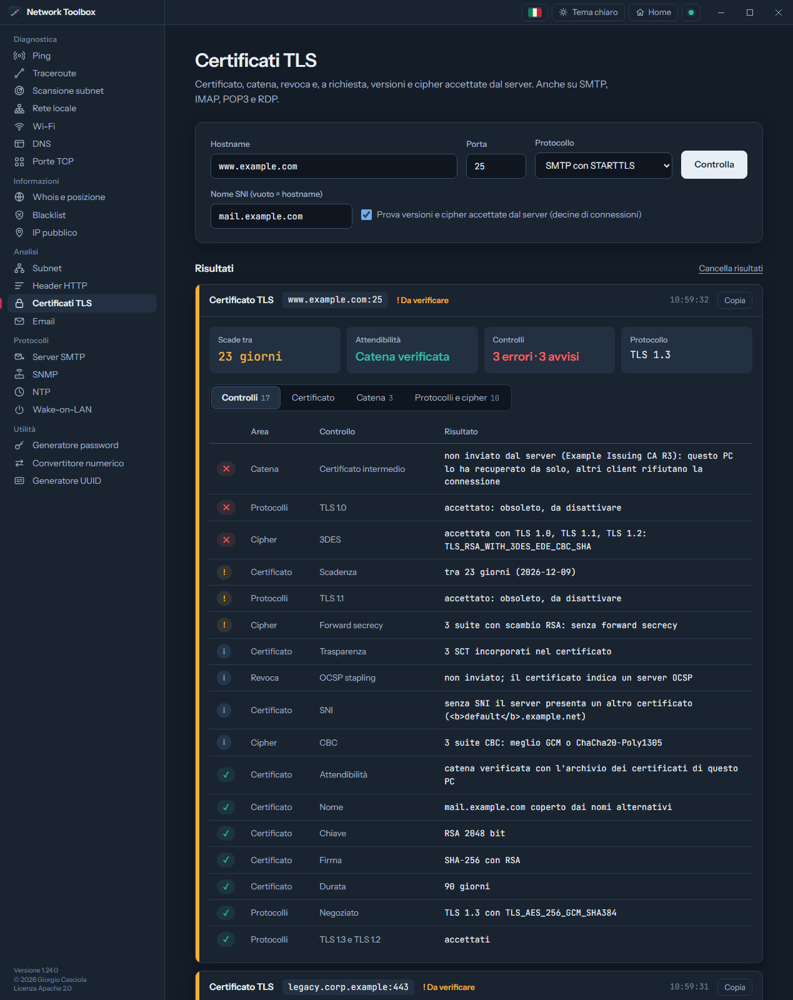
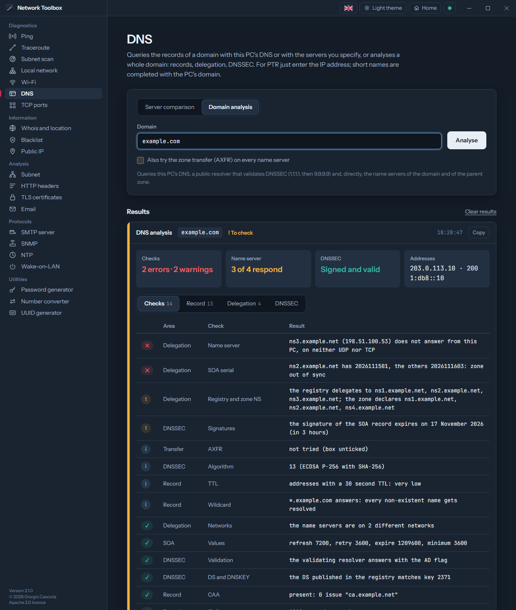
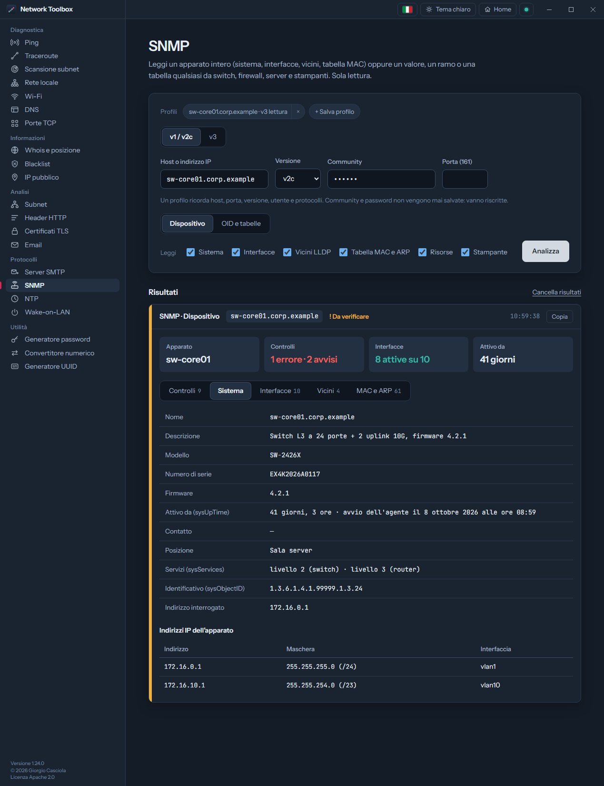
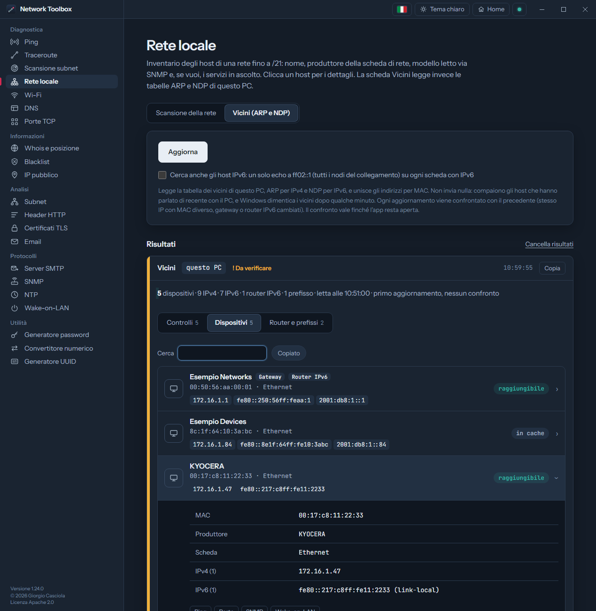
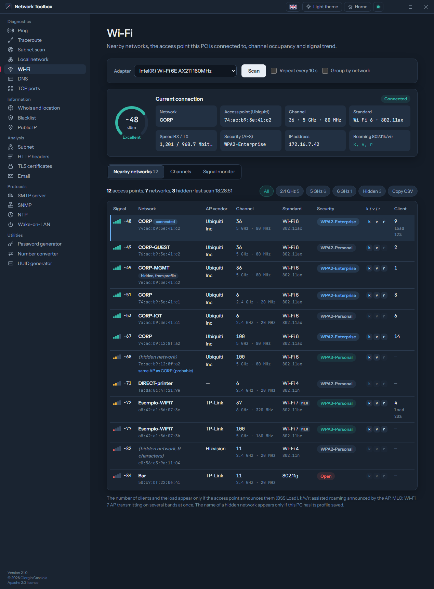

English: [README.md](README.md)

# Network Toolbox

**Strumenti di diagnostica di rete per sistemisti: una sola app desktop per Windows (Rust + Tauri 2)
che esegue ogni test dal tuo PC.** Ping, traceroute, scansioni, DNS, TLS, SNMP, Wi-Fi e altro, con
interfaccia bilingue (italiano e inglese), senza runtime da installare, senza telemetria e senza
servizi cloud: dal PC esce solo il traffico di rete che avvii tu.



## Funzioni

| Area | Strumenti |
|---|---|
| Diagnostica | Ping e traceroute (in diretta, con i nomi), scansione subnet, **Rete locale** (inventario fino a /21: nome, produttore, modello SNMP, tipo di dispositivo, servizi; scheda **Vicini** con le tabelle ARP/NDP del PC), Wi-Fi (reti vicine, canali, monitor del segnale), DNS (confronto tra server e analisi completa del dominio: delega, SOA, DNSSEC), porte TCP |
| Informazioni | Whois e posizione, blacklist (DNSBL), IP pubblico |
| Analisi | Calcolo subnet, header HTTP di sicurezza, **certificati TLS** (catena, revoca, versioni e cipher accettate, STARTTLS), **email** (SPF valutato con l'albero dei lookup, DMARC, DKIM, MTA-STS, analisi degli header) |
| Protocolli | Test del server SMTP, **SNMP** v1/v2c/v3 (sola lettura: apparato, interfacce, LLDP, tabelle MAC/ARP, risorse, stampanti, contatori dal vivo), NTP, Wake-on-LAN |
| Utilità | Generatore di password, convertitore numerico, generatore di UUID (tutti locali) |

Gli strumenti che danno un verdetto mostrano un elenco di controlli in ordine di gravità, e dove ha
senso ogni risultato si può copiare o esportare in CSV.

<p>




</p>

*(Screenshot: interfaccia italiana, dati di esempio con nomi e indirizzi riservati.)*

## Installazione

1. Scarica l'installer dalla pagina **Releases** del repository: l'`.msi` (consigliato) oppure il
   `-setup.exe`.
2. Controlla il download con `SHA256SUMS.txt`:
   ```powershell
   Get-FileHash ".\Network Toolbox_<versione>_x64_it-IT.msi" -Algorithm SHA256
   ```
3. Avvia l'installer. Requisiti: Windows 10 o 11 (64 bit) con il runtime WebView2 (già presente
   nelle versioni attuali di Windows).

**I binari non sono firmati.** Windows SmartScreen può mostrare "Windows ha protetto il PC" e alcuni
prodotti di protezione degli endpoint (EDR) possono trattenere o segnalare il primo avvio, soprattutto
degli strumenti di scansione. È normale per un programma non firmato: verifica l'hash SHA-256, oppure
compila il programma da solo (vedi *Build dell'installer*). La firma è descritta in *Firma del codice*.

## Uso responsabile

Gli strumenti di scansione e sondaggio (scansione subnet, rete locale, porte TCP, SNMP, SMTP, TLS)
inviano traffico vero. **Usali solo su reti e host tuoi o che sei autorizzato a verificare.** I
prodotti di sicurezza registreranno le scansioni. L'accesso SNMP è in sola lettura: l'app non invia
mai richieste SET.

## Licenza

Network Toolbox è rilasciato con **licenza Apache 2.0** (vedi [`LICENSE`](LICENSE) e
[`NOTICE`](NOTICE)). I componenti di terze parti (font con licenza SIL OFL, registro OUI dell'IEEE,
crate Rust) sono elencati in [`THIRD-PARTY-LICENSES.md`](THIRD-PARTY-LICENSES.md). Per segnalare un
problema di sicurezza vedi [`SECURITY.md`](SECURITY.md); per contribuire vedi
[`CONTRIBUTING.md`](CONTRIBUTING.md).

---

*Le sezioni seguenti sono la documentazione tecnica del progetto.*

## Lingua

L'app è bilingue: **italiano (predefinito) e inglese**. La lingua si sceglie con la bandierina accanto
al pulsante del tema nella barra superiore e viene ricordata in `localStorage` (`ntb-lang`). Il tema
scuro è quello predefinito (la preferenza di sistema non viene più usata).

- **Backend**: i messaggi (errori, controlli, note, righe di evento) seguono la lingua impostata
  dall'interfaccia con il comando `set_lang`. Il codice è in `core/src/i18n.rs`; i testi si scrivono
  con le macro `t!("italiano", "english")` e `tf!(...)` (la seconda funziona come `format!`).
- **Interfaccia**: i testi passano da `__()` in `ui/app.js` (la chiave è il testo italiano); i
  dizionari inglesi sono i file `ui/i18n/en-*.js`. L'HTML statico si traduce al caricamento. Una voce
  mancante ricade sull'italiano.
- Documenti: la versione principale è in inglese; il README italiano è `README.it.md`. I commenti
  del codice sono in inglese.

## Struttura

```
nettoolbox-desktop/
├── core/              libreria di rete, senza dipendenze da Tauri (testabile da sola)
│   └── src/
│       ├── icmp/      echo ICMP e ARP: windows_impl.rs (IP Helper API) e unix_impl.rs (solo sviluppo)
│       ├── tcp.rs     connessioni TCP di sonda: aperta, rifiutata, nessuna risposta
│       ├── selftest.rs  collaudo del motore delle scansioni sul PC (test da lanciare a mano)
│       ├── net.rs     validazione host, risoluzione nomi, reverse DNS
│       ├── netbios.rs nome NetBIOS (UDP 137) quando manca il PTR
│       ├── dns.rs     query DNS dirette (UDP, TCP se troncato) e DNS di sistema
│       ├── blacklist.rs  controllo DNSBL
│       ├── ports.rs   porte TCP con banner
│       ├── whois.rs   whois con rimandi IANA → registro
│       ├── subnet.rs  calcolo subnet
│       ├── myip.rs    IP pubblico e informazioni su un IP (ipinfo.io)
│       ├── http.rs    header HTTP: catena dei redirect e analisi di sicurezza
│       ├── http/analyze.rs  cookie, CSP, HSTS, CDN (funzioni pure)
│       ├── dns/domain.rs  analisi di un dominio: record, delega, DNSSEC, AXFR
│       ├── dns/rdata.rs   record DNSSEC letti dai byte (DNSKEY, DS, RRSIG, NSEC3PARAM)
│       ├── tls.rs     certificati TLS (rustls + store certificati di sistema)
│       ├── tls/legacy.rs  sonda di compatibilità per server TLS legacy
│       ├── tls/cert.rs    dettagli del certificato, catena e controlli (funzioni pure)
│       ├── tls/starttls.rs  STARTTLS per SMTP, IMAP, POP3 e negoziazione RDP
│       ├── tls/scan.rs    versioni e cipher accettate dal server (facoltativa)
│       ├── tls/windows_impl.rs  catena costruita da Windows (CertGetCertificateChain)
│       ├── email.rs   analisi di un dominio di posta e degli header di un messaggio
│       ├── email/spf.rs     SPF: albero dei meccanismi, limite di 10 lookup, esito per un IP
│       ├── email/policy.rs  DMARC, chiavi DKIM, MTA-STS, TLS-RPT
│       ├── email/message.rs header: percorso con i ritardi, allineamento, antispam
│       ├── ntp.rs     client SNTP
│       ├── smtp.rs    test di un server SMTP (STARTTLS/TLS, relay, AUTH, invio di prova)
│       ├── snmp/      SNMP v1/v2c/v3: ber.rs, client.rs, usm.rs (crittografia), mib.rs (nomi
│       │              integrati), table.rs (tabelle e CSV), device.rs (apparato intero),
│       │              monitor.rs (contatori dal vivo), fake.rs (agente finto per i test)
│       ├── ping.rs    ping
│       ├── trace.rs   traceroute
│       ├── sweep.rs   scansione subnet
│       ├── lan.rs     rete locale: inventario fino a /21, produttori (OUI), SNMP, servizi, tipo
│       ├── netpath/   route predefinita, gateway e tipo di scheda (schermata iniziale)
│       ├── wol.rs     Wake-on-LAN
│       ├── wifi/      Wi-Fi: ie.rs (Information Element dei beacon), windows_impl.rs (wlanapi.dll
│       │              caricata a runtime), reti, canali, sicurezza, monitor del segnale
│       ├── pwgen.rs   generatore di password (nessuna rete)
│       └── clipboard/ appunti di Windows per le password: fuori da Win+V, svuotati dopo 30 s
├── src-tauri/         guscio Tauri: comandi esposti all'interfaccia, configurazione, icone
│   └── resources/     file di dati installati accanto all'exe: oui.txt (produttori dal
│                      registro pubblico IEEE)
├── ui/                interfaccia (HTML/JS statici; ogni operazione è un comando Tauri)
│   └── fonts/         font inclusi (OFL), l'app funziona anche senza Internet
└── build.ps1          build di rilascio: test, installer, firma, hash SHA-256
```

## Prerequisiti (una volta sola, PowerShell da amministratore)

```powershell
winget install Rustlang.Rustup
winget install Microsoft.VisualStudio.2022.BuildTools --override "--add Microsoft.VisualStudio.Workload.VCTools --includeRecommended --passive"
```

Chiudi e riapri PowerShell (così trova `cargo` nel PATH), poi:

```powershell
cargo install tauri-cli --version "^2" --locked
```

WebView2 è già presente in Windows 10 e 11.

## Sviluppo

Dalla cartella `nettoolbox-desktop`:

```powershell
cargo tauri dev
```

La prima compilazione richiede qualche minuto. Le modifiche ai file in `ui/` si vedono
ricaricando la finestra (Ctrl+R), quelle al codice Rust ricompilano e riavviano l'app da sole.

Test della libreria di rete:

```powershell
cargo test -p ntb-core
```

## Build dell'installer

```powershell
.\build.ps1                          # senza firma
.\build.ps1 -Thumbprint <impronta>   # firmata (certificato in Cert:\CurrentUser\My)
```

Lo script esegue i test, compila, crea gli installer e copia tutto in `release\` con il file
`SHA256SUMS.txt`. In alternativa, senza script: `cargo tauri build`.

Risultati in `target\release\bundle\`:

- `msi\Network Toolbox_0.1.0_x64_it-IT.msi`, adatto alla distribuzione centralizzata
- `nsis\Network Toolbox_0.1.0_x64-setup.exe`

L'eseguibile da solo è `target\release\nettoolbox.exe`.

### Firma del codice

Un eseguibile firmato evita gli avvisi di SmartScreen e permette all'EDR di riconoscerlo per
editore invece che per hash (che cambia a ogni versione). Due strade:

- **Certificato da una CA interna**, modello "Firma codice": gratuito, attendibile su tutti
  i PC del dominio. Il certificato della CA va pubblicato anche tra gli *Editori attendibili* via GPO.
- **Certificato commerciale OV/EV**: necessario solo se l'app deve girare fuori dal dominio.

Impronta del certificato installato:

```powershell
Get-ChildItem Cert:\CurrentUser\My -CodeSigningCert | Select-Object Thumbprint, Subject, NotAfter
```

### Distribuzione centralizzata

Installazione silenziosa per tutti gli utenti del PC:

```powershell
msiexec /i "Network Toolbox_2.0.0_x64_it-IT.msi" /qn /norestart
```

Una versione più recente aggiorna quella installata: l'upgrade code dell'MSI è fissato in
`tauri.conf.json` (`bundle.windows.wix.upgradeCode`) e non va mai cambiato. L'identificatore
dell'app è `it.giocas.nettoolbox`. WebView2 è già presente su Windows 10/11; se manca,
l'installer lo scarica.

## Note tecniche

- **ICMP senza privilegi**: su Windows ping e traceroute usano `IcmpSendEcho` (IP Helper),
  la stessa API di `ping.exe` e `tracert.exe`. Non serve eseguire come amministratore.
- **Nomi degli host**: record PTR e nome NetBIOS si cercano insieme (il PTR ha la
  precedenza), il NetBIOS solo per gli indirizzi privati. Ping e traceroute partono subito e
  cercano il nome del target in parallelo al primo pacchetto.
- **Traceroute**: i salti si provano a blocchi di 8 TTL insieme e le righe escono
  in ordine; i nomi dei router si cercano in parallelo. Otto salti muti di fila chiudono il
  traceroute dopo un solo timeout.
- **Scansioni** (subnet e Rete locale): in due tempi. Prima chi c'è: un echo per
  indirizzo (due tentativi da 800 ms), avviati a gruppi di 128 ogni 250 ms; sulle reti collegate
  direttamente al PC il MAC si legge dalla tabella ARP di Windows (`GetIpNetTable2`), che contiene
  anche gli host che bloccano il ping, perché il ping stesso obbliga Windows a risolverne
  l'indirizzo. Poi, solo per gli host trovati, i nomi (e nella Rete locale SNMP e servizi): la
  riga compare subito e si completa quando arrivano. Gli echo delle scansioni passano da
  `IcmpSendEcho2Ex` su un unico thread dedicato, senza un thread per sonda; se quel motore non
  parte o non risponde si torna da soli a `IcmpSendEcho`, e se la tabella ARP non è leggibile a
  `SendARP`. Sulle reti remote restano ICMP e, se attivata, la verifica TCP. "Scansiona rete"
  diventa "Ferma" mentre la scansione gira; a scansione chiusa la tabella è in ordine di indirizzo.
- **Porte TCP**: le porte aperte compaiono appena trovate, con avanzamento e
  "Ferma"; 500 connessioni insieme. Windows ritenta il SYN dopo un rifiuto e segnala la porta
  chiusa dopo circa un secondo: per evitarlo ogni porta si prova prima con un socket senza
  ritrasmissione del SYN (`SIO_TCP_INITIAL_RTO`), che vale solo per le risposte certe (aperta o
  rifiutata); senza una risposta certa entro 1 s si riprova con un socket normale e 3 s.
- **Collaudo del motore sul PC**: `cargo test -p ntb-core collaudo_motore -- --ignored --nocapture`
  stampa quale echo usano le scansioni, se la tabella ARP è leggibile e quanto impiega un
  rifiuto TCP.
- **Nomi brevi**: la risoluzione usa il resolver di Windows, quindi `srv01` diventa
  `srv01.corp.example` con i suffissi DNS del dominio.
- **Wake-on-LAN**: con 255.255.255.255 il pacchetto parte anche dal broadcast di ogni scheda di
  rete, quindi funziona pure su PC con più interfacce (Wi-Fi + cavo, VPN).
- **DNS**: le query partono direttamente verso il server scelto (come `dig @server`), quindi si
  vedono codice di risposta, TTL e tempi. ID casuale e socket connesso al server: si accettano
  solo risposte con lo stesso ID e la stessa domanda (anche via TCP dopo una risposta troncata). Il "resolver di sistema" è il primo DNS configurato sul
  PC; i nomi brevi vengono completati con il suffisso DNS del dominio.
- **Blacklist**: usa il DNS del PC. "In lista" solo con codici 127.x.x.x; un altro indirizzo
  (DNS che risolve qualunque nome) è segnalato come risposta inattesa. Se il DNS inoltra a 8.8.8.8 o 1.1.1.1, Spamhaus rifiuta le
  query e la lista risulta "non verificabile".
- **IP pubblico**: richiesta HTTPS a ipinfo.io. Su Windows passa dallo store certificati e dal
  proxy di sistema.
- **DNS, analisi del dominio**: tre sorgenti. Il DNS del PC per i record; i
  name server della zona padre e del dominio interrogati direttamente, senza ricorsione, per
  delega, seriali e DS; un resolver pubblico che valida DNSSEC (1.1.1.1, poi 9.9.9.9) per
  sapere se la catena regge (stessa query normale e con il bit CD). Le firme non vengono
  verificate dall'app: si controlla che DS, chiavi e scadenze siano coerenti (il digest del
  DS è ricalcolato). Da una rete che non lascia uscire la porta 53 le query dirette non
  arrivano: il risultato lo dice e non segna errori. I name server si interrogano solo su
  IPv4. Il trasferimento di zona si prova solo a richiesta e si ferma al primo messaggio.
- **Email**: tutte le query passano dal DNS del PC. Il record SPF viene
  percorso per intero, compresi gli `include` annidati, e le ricerche DNS si contano nel caso
  peggiore (RFC 7208: `include`, `a`, `mx`, `ptr`, `exists` e `redirect` ne costano una, gli
  indirizzi dei server MX non contano); i nomi con una macro non si possono valutare senza un
  messaggio. I selettori DKIM non si possono elencare dal DNS: si provano i nomi più comuni,
  oppure quello indicato nel form o letto dagli header. L'unica connessione che non è una
  query DNS è la richiesta HTTPS della policy MTA-STS (`https://mta-sts.<dominio>/…`), fatta
  solo se il record TXT esiste, con il certificato verificato e senza seguire redirect.
  Negli header di un messaggio valgono solo gli esiti del primo `Authentication-Results`
  (quelli più in basso possono venire dal mittente); gli orari dei `Received` sono quelli
  scritti dai server, quindi i ritardi dipendono dai loro orologi.
- **Certificati TLS**: la catena viene verificata con lo store certificati di Windows, quindi CA
  aziendali e mkcert importate risultano attendibili. I dettagli si leggono anche quando il
  certificato non è valido. L'handshake completo usa TLS 1.2 e 1.3. Server legacy: se il server rifiuta
  l'handshake (reset, chiusura, alert di protocollo o di cipher)
  l'app riprova con solo TLS 1.2 e poi con una sonda di compatibilità che offre TLS 1.0–1.2 e
  cipher obsolete (CBC, scambio RSA, 3DES, RC4) e legge il certificato dal ServerHello senza
  completare l'handshake; il risultato lo dice ("Compatibilità", protocollo e cipher scelti dal
  server). Timeout e porte non TLS non attivano i ripieghi. Il test SMTP (STARTTLS) usa solo
  l'handshake normale. Il risultato è un elenco di controlli più tre schede:
  certificato completo (chiave, firma, impronte, usi, indirizzi OCSP/CRL/AIA, SCT), catena dal
  server alla radice e, a richiesta, versioni e cipher accettate. La catena è quella che
  costruisce Windows (`CertGetCertificateChain`): così si vede anche la CA intermedia che il
  server non invia e che Windows recupera da solo; se Windows non la costruisce si mostrano i
  soli certificati inviati. Lo strumento passa a TLS anche su SMTP, IMAP, POP3 (STARTTLS) e
  RDP, e il nome SNI può essere diverso dall'host. La scansione di versioni e cipher fa
  decine di connessioni in sequenza (un IPS può bloccarle a metà: in quel caso il risultato
  dice dove si è fermata); OCSP e CRL non vengono interrogati, si legge solo ciò che server e
  certificato dichiarano.
- **Header HTTP**: i redirect vengono seguiti uno per uno e mostrati, con il trasporto di ogni
  passo. Il certificato è verificato (store di Windows); se non è valido la richiesta si ripete
  senza verifica e il risultato è marcato "risposta non autenticata". La
  richiesta è un GET (si leggono solo gli header) e la risposta viene analizzata: elenco di
  controlli `ok`/`warn`/`err`/`info` per area (trasporto e HSTS, header di sicurezza,
  Content-Security-Policy, cookie, server e CDN). I valori dei cookie non lasciano mai il
  backend. Con un indirizzo `https://` sulla porta 443 si prova anche `http://` sullo stesso
  host, per vedere se porta a HTTPS.
- **NTP**: client SNTP diretto (UDP 123); lo scarto è calcolato rispetto all'orologio del PC.
  Si accetta solo la risposta del server interrogato (socket connesso) con l'originate timestamp
  uguale al transmit della richiesta. SNTP non autentica l'ora (servirebbe NTS).
- **SNMP**: implementazione propria, senza OpenSSL. v1/v2c; v3 con autenticazione MD5, SHA-1,
  SHA-224/256/384/512 e cifratura DES o AES-128. AES-192/256 non sono supportati: esistono
  varianti diverse tra produttori. Walk con GETBULK, fino a 10.000 valori o 60 secondi.
  Solo lettura: nessuna SET. Lettura di un apparato intero a schede (sistema,
  interfacce, vicini LLDP, tabella MAC e ARP) con i controlli di sicurezza sulla richiesta
  (community predefinita, versioni in chiaro, livello e algoritmi v3); contatori delle
  interfacce dal vivo (una lettura ogni 5 s, velocità dalla differenza fra due letture, a
  64 bit se l'agente li ha); qualsiasi tabella a righe e colonne con CSV; nomi di 10 MIB
  standard integrati nel programma (nessun file MIB), con suggerimenti e albero. I profili
  salvano host, porta, versione, utente e protocolli, mai community o password. Anche le viste
  **Risorse** (processori, memoria, dischi, processi: HOST-RESOURCES-MIB)
  e **Stampante** (stato, toner e materiali, vassoi, allarmi, pagine: Printer-MIB), che
  compaiono solo se l'apparato espone i dati.
- **Server SMTP**: client SMTP proprio con trascrizione e tempo di ogni risposta. Banner,
  reverse DNS (PTR e ritorno A), nome generico del provider, EHLO, STARTTLS o TLS implicito
  (465) con il certificato verificato dallo store di Windows, AUTH offerta prima di TLS. Test di
  open relay (opzionale) con MAIL FROM/RCPT TO verso example.com/example.net, **mai DATA**.
  Login (PLAIN o LOGIN) solo su TLS con certificato verificato, password mascherata nella
  trascrizione. Invio di prova (opzionale) con Date, Message-ID e corpo in base64. Dopo
  STARTTLS i dati ricevuti in chiaro interrompono la sessione (iniezione di comandi).
  In v3 le risposte valgono solo se rispettano il livello richiesto (flag auth/priv, HMAC
  verificato a tempo costante prima di usare qualsiasi campo, engine ID, utente, msgID,
  request-id, finestra temporale); i Report non protetti diventano sempre un errore.
- **Generatore password**: casualità dal generatore crittografico di Windows (`ProcessPrng`, via
  `getrandom`). Le password sono estratte in modo uniforme tra tutte quelle che rispettano tipi e
  minimi, quindi l'entropia mostrata è esatta. "Copia" usa le API Win32 degli appunti con i formati
  `CanIncludeInClipboardHistory`, `CanUploadToCloudClipboard` ed
  `ExcludeClipboardContentFromMonitorProcessing`, e svuota gli appunti dopo 30 secondi (e alla
  chiusura dell'app) se contengono ancora la password. La cronologia resta solo in memoria.
- **Rete locale**: scoperta come descritto in "Scansioni"; i dettagli si raccolgono per 64
  host alla volta. Per ogni host: PTR e NetBIOS,
  produttore dal prefisso del MAC (`oui.txt`, prefisso più lungo tra MA-S, MA-M e MA-L; i MAC
  amministrati localmente sono "casuali"), SNMP v2c `public` (sysName, sysDescr, sysObjectID,
  hrDeviceDescr.1, che nelle stampanti è il modello). Con "servizi": 21 porte TCP con banner e
  ricerca via TCP (6 porte) degli host che non rispondono al ping. Il tipo di dispositivo si
  ricava da produttore, SNMP, NetBIOS e porte. Per aggiornare i produttori: riscaricare i tre CSV
  IEEE e rigenerare `oui.txt` (formato `prefisso<TAB>produttore`).
- **Rete locale, scheda Vicini** (`core/src/neigh/`): lettura passiva della
  tabella dei vicini di Windows (`GetIpNetTable2` con `AF_UNSPEC`: ARP e NDP), unita per MAC
  in `Device` (IPv4 e IPv6, produttore da `oui.txt`, stato, gateway e router IPv6); i router
  IPv6 e i prefissi vengono dalle route annunciate (`GetIpForwardTable2`, origine Router
  Advertisement) e i nomi delle schede da `GetIfEntry2`. Unione, controlli, confronto con la
  lettura precedente e CSV sono funzioni pure su una lettura grezza (`Raw`), provate con
  letture finte; il guscio tiene l'ultima lettura per il confronto. Se `GetIpNetTable2` non
  risponde si ripiega sulla sola tabella ARP IPv4 (`source` = `ripiego-ipv4`). Con la
  casella dedicata si invia un solo echo ICMPv6 (`Icmp6SendEcho2`) a `ff02::1` per scheda e
  si rilegge la tabella.
- **Schermata iniziale**: percorso PC → gateway → Internet. Scheda e gateway da `GetBestRoute`
  verso 1.1.1.1 e `GetIfEntry2` (tipo: cavo, Wi-Fi o VPN, anche dalla descrizione del driver, es.
  "Fortinet SSL VPN"); latenze dal ping al gateway e dal controllo Internet, ogni 30 s; IP pubblico
  e provider da ipinfo.io solo all'avvio, quando cambiano IP del PC o gateway, e con Home.
  La Home ha come sfondo una mappa del mondo (`ui/home-map.webp`) con orizzonte e
  griglia (`ui/home-ground.webp`), ricavate da un'immagine fornita dall'utente; nel tema chiaro
  sono le stesse immagini invertite via CSS. Percorso in alto, orologio in basso al centro;
  versione e crediti in fondo al menu laterale (nascosti se la finestra è più bassa di 848 px).
- **Wi-Fi**: Native Wi-Fi API di Windows (`wlanapi.dll`), senza driver né
  privilegi. La DLL si carica a runtime: su Windows Server senza "Servizio LAN wireless" non
  esiste, e un'importazione statica impedirebbe l'avvio dell'app. Reti vicine da
  `WlanGetNetworkBssList` dopo una scansione (`WlanScan`, fine segnalata da notifica, ~4 s);
  standard, larghezza del canale, sicurezza, 802.11k/v/r, client e MLO si leggono dagli
  Information Element dei beacon (HT, VHT, HE, EHT, RSN, BSS Load, Multi-Link), quindi un AP
  Wi-Fi 7 si riconosce anche da una scheda Wi-Fi 6. Reti nascoste: il nome compare solo se il PC
  ne ha il profilo; altrimenti la lunghezza (se l'AP la trasmette) e il probabile AP "gemello"
  dal BSSID. Connessione attuale da `WlanQueryInterface` (RSSI, canale, velocità, sicurezza).
  Consigli: canale più libero tra 1, 6 e 11 e gruppo da 80 MHz tra quelli ammessi in Europa
  all'interno (36–64, 100–128). Monitor del segnale ogni 0,5–5 s con roaming (cambio di BSSID,
  interruzione dalle notifiche di Windows), disconnessioni e soglie −67/−75 dBm. Da Windows 11
  24H2 reti vicine e BSSID richiedono l'accesso alla posizione per le app desktop: se è negato
  l'app lo dice. Niente monitor mode (client, deauth, spettro). Collaudo sul PC:
  `cargo test -p ntb-core collaudo_wifi -- --ignored --nocapture`.
- **Solo IPv4** in questa versione.
- **Antivirus**: un eseguibile non firmato che fa ping sweep può essere segnalato da Defender o
  dall'EDR. In produzione conviene firmarlo, oppure aggiungere un'esclusione via policy.

## Controllo del codice Windows da Linux

Il backend Windows può essere controllato (non eseguito) anche da Linux:

```bash
RUSTFLAGS="--cfg ntb_check_windows" cargo check -p ntb-core --target-dir target/wincheck
```

## Roadmap

1. ✅ Ping, traceroute, scansione subnet, Wake-on-LAN
2. ✅ DNS con confronto server, blacklist, porte TCP, whois, calcolo subnet, IP pubblico
3. ✅ Header HTTP, certificati TLS, email, NTP, SNMP v1/v2c/v3 (LDAP/AD tolto)
4. ✅ Build di rilascio, font inclusi, metadati installer, script di firma
5. ✅ Generatore di password
6. ✅ Rete locale
7. ✅ Convertitore numerico e generatore UUID, server SMTP
9. ✅ Wi-Fi: reti vicine, canali, monitor del segnale
8. ⬜ Collaudo completo, firma e distribuzione

## Test con server veri

I test di SNMP usano un agente finto su 127.0.0.1 (`snmp/fake.rs`: v1 e v2c, GET, GETNEXT e
GETBULK sopra una piccola MIB in memoria). In più c'è una prova contro un agente vero, attiva
solo se indicato:

```bash
NTB_SNMP_TEST=16100 cargo test -p ntb-core
```

(Net-SNMP su 127.0.0.1:16100 con la community `public`, `sysName test-agent`,
`sysLocation Sala server` e gli utenti v3 `u_*`: password `authpass123` e
`privpass123`; l'elenco è nel test `snmp::tests::agente_vero`).
