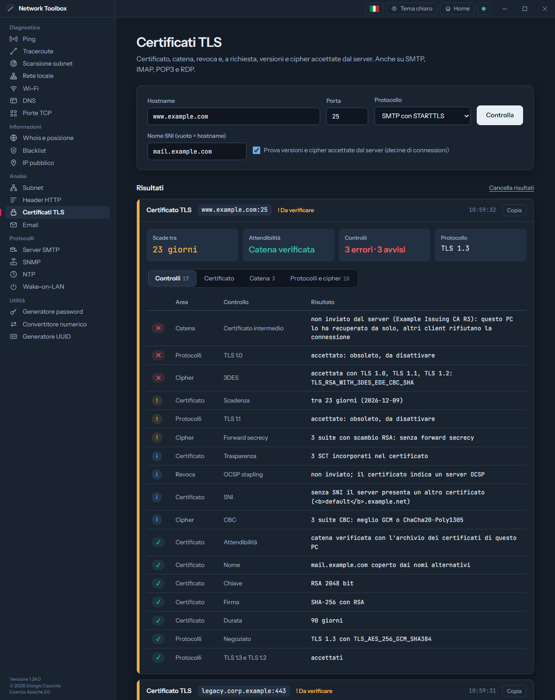
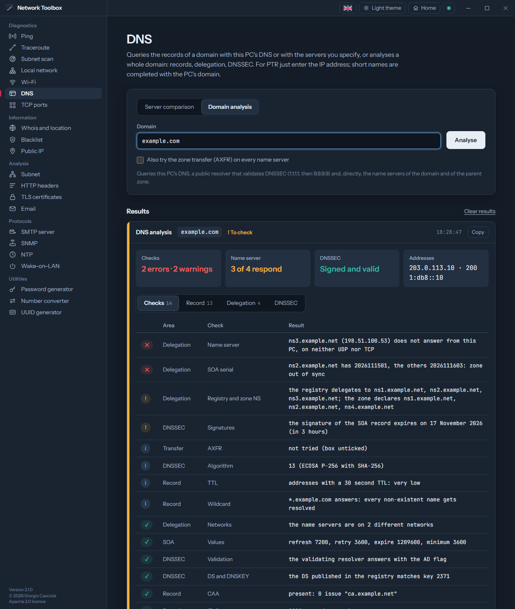
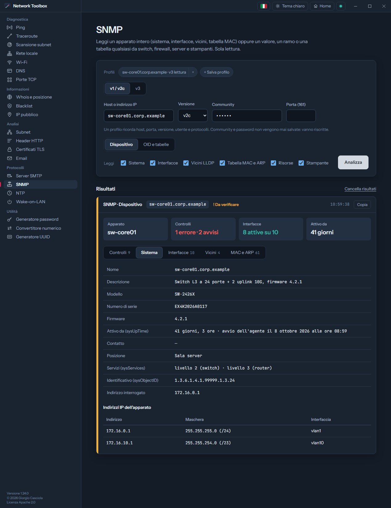
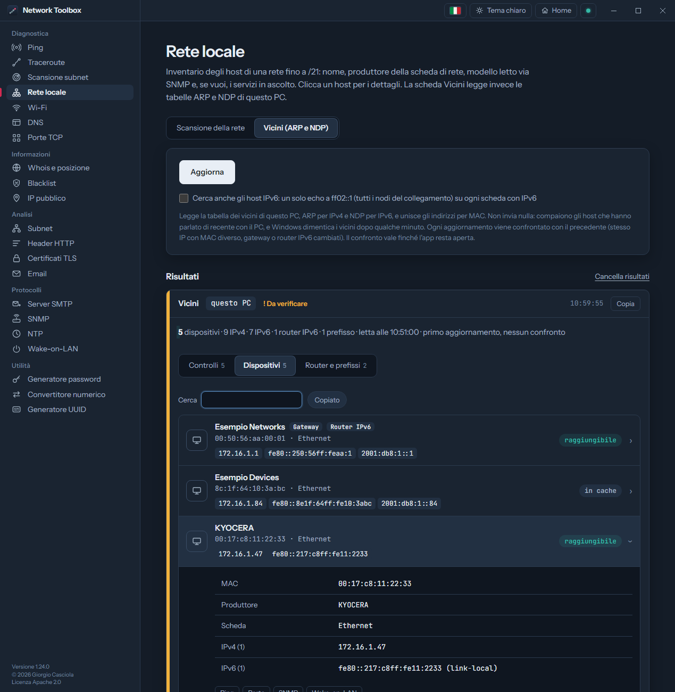
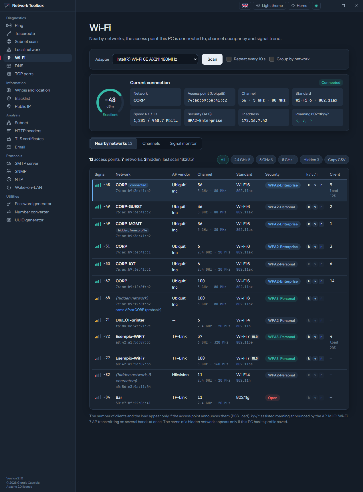

Italiano: [README.it.md](README.it.md)

# Network Toolbox

**Network diagnostic tools for system administrators: a single Windows desktop app (Rust + Tauri 2)
that runs every test from your own PC.** Ping, traceroute, scans, DNS, TLS, SNMP, Wi-Fi and more,
with a bilingual interface (Italian and English), no runtimes to install, no telemetry and no
cloud service: nothing leaves the PC except the network requests you start.



## Features

| Area | Tools |
|---|---|
| Diagnostics | Ping and traceroute (live, with host names), subnet scan, **Local network** (inventory up to /21: name, vendor, SNMP model, device type, services; **Neighbours** tab with the ARP/NDP tables of the PC), Wi-Fi (nearby networks, channels, signal monitor), DNS (comparison between servers and full domain analysis: delegation, SOA, DNSSEC), TCP ports |
| Information | Whois and location, blacklist (DNSBL), public IP |
| Analysis | Subnet calculator, HTTP security headers, **TLS certificates** (chain, revocation info, accepted versions and ciphers, STARTTLS), **email** (SPF evaluated with the lookup tree, DMARC, DKIM, MTA-STS, message header analysis) |
| Protocols | SMTP server test, **SNMP** v1/v2c/v3 (read-only: device, interfaces, LLDP, MAC/ARP tables, resources, printers, live counters), NTP, Wake-on-LAN |
| Utilities | Password generator, number converter, UUID generator (all local) |

The tools that give a verdict show a list of checks sorted by severity, and where it makes sense
every result can be copied or exported as CSV.

<p>




</p>

*(Screenshots: Italian interface, sample data with reserved example names and addresses.)*

## Installation

1. Download the installer from the repository **Releases** page: the `.msi` (recommended) or the
   `-setup.exe`.
2. Check the download against `SHA256SUMS.txt`:
   ```powershell
   Get-FileHash ".\Network Toolbox_<version>_x64_it-IT.msi" -Algorithm SHA256
   ```
3. Run the installer. Requirements: Windows 10 or 11 (64 bit) with the WebView2 runtime (already
   present on current Windows versions).

**The binaries are not code-signed.** Windows SmartScreen may show "Windows protected your PC" and
some endpoint protection (EDR) products may hold back or flag the first run, especially of the
scanning tools. This is expected for an unsigned program: verify the SHA-256 hash, or build the
program yourself (see *Building the installer* below). Signing is described in *Code signing*.

### Portable version

The `NetworkToolbox-<version>-portable.zip` file on the Releases page needs no installation: unzip
it anywhere (for example on a USB stick) and run `NetworkToolbox.exe`. Keep `oui.txt` next to the
exe. While `portable.txt` is next to the exe, settings (language, theme, profiles) are saved in the
`data` folder beside it and nothing is written to the PC's user profile; delete `portable.txt` to
use the normal location. The same SmartScreen/EDR notes apply, and the portable version does not
install the WebView2 runtime.

## Responsible use

The scanning and probing tools (subnet scan, local network, TCP ports, SNMP, SMTP, TLS) send real
traffic. **Use them only on networks and hosts you own or are authorised to test.** Security
products will record the scans. SNMP access is read-only: the app never sends SET requests.

## Licence

Network Toolbox is released under the **Apache License 2.0** (see [`LICENSE`](LICENSE) and
[`NOTICE`](NOTICE)). Third-party components (fonts under the SIL OFL, the IEEE OUI registry, Rust
crates) are listed in [`THIRD-PARTY-LICENSES.md`](THIRD-PARTY-LICENSES.md). To report a security
problem see [`SECURITY.md`](SECURITY.md); to contribute see [`CONTRIBUTING.md`](CONTRIBUTING.md).

---

*The sections below are the technical documentation of the project.*

## Language

The app is bilingual: **Italian (default) and English**. The language is chosen with the flag
button next to the theme button in the top bar and is remembered in `localStorage`
(`ntb-lang`). The dark theme is the default (the system preference is no longer used).

- **Backend**: messages (errors, checks, notes, event lines) follow the language set by the
  UI through the `set_lang` command. The code is in `core/src/i18n.rs`; texts are written with
  the `t!("italian", "english")` and `tf!(...)` macros (the latter works like `format!`).
- **UI**: texts go through `__()` in `ui/app.js` (the key is the Italian text); the English
  dictionaries are the `ui/i18n/en-*.js` files. Static HTML is translated at load. A missing
  entry falls back to Italian.
- Documents: English is the main version; the Italian README is `README.it.md`. Code comments
  are in English.

## Structure

```
nettoolbox-desktop/
├── core/              network library, no Tauri dependencies (testable on its own)
│   └── src/
│       ├── icmp/      ICMP echo and ARP: windows_impl.rs (IP Helper API) and unix_impl.rs (development only)
│       ├── tcp.rs     probe TCP connections: open, refused, no answer
│       ├── selftest.rs  scan engine self-test on the PC (tests to run by hand)
│       ├── net.rs     host validation, name resolution, reverse DNS
│       ├── netbios.rs NetBIOS name (UDP 137) when the PTR is missing
│       ├── dns.rs     direct DNS queries (UDP, TCP if truncated) and system DNS
│       ├── blacklist.rs  DNSBL check
│       ├── ports.rs   TCP ports with banners
│       ├── whois.rs   whois with IANA → registry referrals
│       ├── subnet.rs  subnet calculator
│       ├── myip.rs    public IP and information about an IP (ipinfo.io)
│       ├── http.rs    HTTP headers: redirect chain and security analysis
│       ├── http/analyze.rs  cookies, CSP, HSTS, CDN (pure functions)
│       ├── dns/domain.rs  domain analysis: records, delegation, DNSSEC, AXFR
│       ├── dns/rdata.rs   DNSSEC records read from the bytes (DNSKEY, DS, RRSIG, NSEC3PARAM)
│       ├── tls.rs     TLS certificates (rustls + system certificate store)
│       ├── tls/legacy.rs  compatibility probe for legacy TLS servers
│       ├── tls/cert.rs    certificate details, chain and checks (pure functions)
│       ├── tls/starttls.rs  STARTTLS for SMTP, IMAP, POP3 and RDP negotiation
│       ├── tls/scan.rs    versions and ciphers accepted by the server (optional)
│       ├── tls/windows_impl.rs  chain built by Windows (CertGetCertificateChain)
│       ├── email.rs   analysis of a mail domain and of a message's headers
│       ├── email/spf.rs     SPF: mechanism tree, 10-lookup limit, result for an IP
│       ├── email/policy.rs  DMARC, DKIM keys, MTA-STS, TLS-RPT
│       ├── email/message.rs headers: path with delays, alignment, anti-spam
│       ├── ntp.rs     SNTP client
│       ├── smtp.rs    SMTP server test (STARTTLS/TLS, relay, AUTH, test message)
│       ├── snmp/      SNMP v1/v2c/v3: ber.rs, client.rs, usm.rs (cryptography), mib.rs (built-in
│       │              names), table.rs (tables and CSV), device.rs (whole device),
│       │              monitor.rs (live counters), fake.rs (fake agent for tests)
│       ├── ping.rs    ping
│       ├── trace.rs   traceroute
│       ├── sweep.rs   subnet scan
│       ├── lan.rs     local network: inventory up to /21, vendors (OUI), SNMP, services, type
│       ├── netpath/   default route, gateway and adapter type (home screen)
│       ├── wol.rs     Wake-on-LAN
│       ├── wifi/      Wi-Fi: ie.rs (beacon Information Elements), windows_impl.rs (wlanapi.dll
│       │              loaded at runtime), networks, channels, security, signal monitor
│       ├── pwgen.rs   password generator (no network)
│       ├── i18n.rs    language of the backend messages (t!/tf! macros, set_lang)
│       └── clipboard/ Windows clipboard for passwords: kept out of Win+V, cleared after 30 s
├── src-tauri/         Tauri shell: commands exposed to the UI, configuration, icons
│   └── resources/     data files installed next to the exe: oui.txt (vendors from the
│                      public IEEE registry)
├── ui/                interface (static HTML/JS; every operation is a Tauri command)
│   ├── fonts/         bundled fonts (OFL), the app also works without Internet
│   └── i18n/          English dictionaries (en-*.js)
└── build.ps1          release build: tests, installers, signing, SHA-256 hashes
```

## Prerequisites (once only, PowerShell as administrator)

```powershell
winget install Rustlang.Rustup
winget install Microsoft.VisualStudio.2022.BuildTools --override "--add Microsoft.VisualStudio.Workload.VCTools --includeRecommended --passive"
```

Close and reopen PowerShell (so it finds `cargo` in the PATH), then:

```powershell
cargo install tauri-cli --version "^2" --locked
```

WebView2 is already present on Windows 10 and 11.

## Development

From the `nettoolbox-desktop` folder:

```powershell
cargo tauri dev
```

The first build takes a few minutes. Changes to files in `ui/` show up by reloading the
window (Ctrl+R); changes to the Rust code rebuild and restart the app on their own.

Network library tests:

```powershell
cargo test -p ntb-core
```

## Building the installer

```powershell
.\build.ps1                          # unsigned
.\build.ps1 -Thumbprint <thumbprint> # signed (certificate in Cert:\CurrentUser\My)
```

The script runs the tests, builds, creates the installers and the portable zip and copies everything to `release\`
together with the `SHA256SUMS.txt` file. Alternatively, without the script: `cargo tauri build`.

Output in `target\release\bundle\`:

- `msi\Network Toolbox_0.1.0_x64_it-IT.msi`, suitable for centralised deployment
- `nsis\Network Toolbox_0.1.0_x64-setup.exe`

The standalone executable is `target\release\nettoolbox.exe`.

### Code signing

A signed executable avoids SmartScreen warnings and lets the EDR recognise it by publisher
instead of by hash (which changes with every version). Two options:

- **Certificate from an internal CA**, "Code Signing" template: free, trusted on every PC
  in the domain. The CA certificate must also be published among the *Trusted Publishers* via GPO.
- **Commercial OV/EV certificate**: needed only if the app has to run outside the domain.

Thumbprint of the installed certificate:

```powershell
Get-ChildItem Cert:\CurrentUser\My -CodeSigningCert | Select-Object Thumbprint, Subject, NotAfter
```

### Centralised deployment

Silent installation for all users of the PC:

```powershell
msiexec /i "Network Toolbox_2.1.0_x64_it-IT.msi" /qn /norestart
```

A newer version upgrades the installed one: the MSI upgrade code is fixed in
`tauri.conf.json` (`bundle.windows.wix.upgradeCode`) and must never be changed. The app
identifier is `it.giocas.nettoolbox`. WebView2 is already present on Windows 10/11; if it is
missing, the installer downloads it.

## Technical notes

- **Unprivileged ICMP**: on Windows ping and traceroute use `IcmpSendEcho` (IP Helper),
  the same API as `ping.exe` and `tracert.exe`. No need to run as administrator.
- **Host names**: the PTR record and the NetBIOS name are looked up together (the
  PTR takes precedence), NetBIOS only for private addresses. Ping and traceroute start at once and
  look up the target's name in parallel with the first packet.
- **Traceroute**: hops are probed in blocks of 8 TTLs at once and the lines come out
  in order; router names are looked up in parallel. Eight silent hops in a row end the
  traceroute after a single timeout.
- **Scans** (subnet and Local network): in two phases. First who is there: one echo
  per address (two attempts of 800 ms), started in groups of 128 every 250 ms; on networks
  directly attached to the PC the MAC is read from the Windows ARP table (`GetIpNetTable2`), which
  also contains hosts that block ping, because the ping itself forces Windows to resolve
  the address. Then, only for the hosts found, the names (and in Local network SNMP and services):
  the row appears immediately and is completed when the data arrive. The scan echoes go through
  `IcmpSendEcho2Ex` on a single dedicated thread, without a thread per probe; if that engine does
  not start or does not answer, the app falls back to `IcmpSendEcho` by itself, and if the ARP
  table cannot be read to `SendARP`. On remote networks only ICMP and, if enabled, the TCP check
  remain. "Scan network" becomes "Stop" while the scan runs; once the scan is closed the table is
  in address order.
- **TCP ports**: open ports appear as soon as they are found, with progress and
  "Stop"; 500 connections at once. Windows retries the SYN after a refusal and reports the closed
  port after about a second: to avoid this every port is first tried with a socket without SYN
  retransmission (`SIO_TCP_INITIAL_RTO`), which is valid only for certain answers (open or
  refused); without a certain answer within 1 s it retries with a normal socket and 3 s.
- **Engine self-test on the PC**: `cargo test -p ntb-core collaudo_motore -- --ignored --nocapture`
  prints which echo the scans use, whether the ARP table is readable and how long a TCP
  refusal takes.
- **Short names**: resolution uses the Windows resolver, so `srv01` becomes
  `srv01.corp.example` with the domain's DNS suffixes.
- **Wake-on-LAN**: with 255.255.255.255 the packet is also sent from the broadcast of every
  network adapter, so it also works on PCs with several interfaces (Wi-Fi + cable, VPN).
- **DNS**: queries go directly to the chosen server (like `dig @server`), so you
  see response code, TTL and timings. Random ID and socket connected to the server: only
  responses with the same ID and the same question are accepted (also via TCP after a truncated
  response). The "system resolver" is the first DNS configured on the PC; short names are
  completed with the domain's DNS suffix.
- **Blacklist**: uses the PC's DNS. "Listed" only with 127.x.x.x codes; any other address
  (a DNS that resolves any name) is reported as an unexpected response. If the DNS forwards to
  8.8.8.8 or 1.1.1.1, Spamhaus refuses the queries and the list shows as "not verifiable".
- **Public IP**: HTTPS request to ipinfo.io. On Windows it goes through the certificate store and
  the system proxy.
- **DNS, domain analysis**: three sources. The PC's DNS for the records; the
  name servers of the parent zone and of the domain queried directly, without recursion, for
  delegation, serials and DS; a public resolver that validates DNSSEC (1.1.1.1, then 9.9.9.9) to
  tell whether the chain holds (same query, normal and with the CD bit). Signatures are not
  verified by the app: it checks that DS, keys and expiry dates are consistent (the DS digest
  is recomputed). From a network that does not let port 53 out the direct queries do not
  arrive: the result says so and does not flag errors. Name servers are queried over IPv4 only.
  The zone transfer is tried only on request and stops at the first message.
- **Email**: all queries go through the PC's DNS. The SPF record is walked in
  full, including nested `include`s, and DNS lookups are counted in the worst case
  (RFC 7208: `include`, `a`, `mx`, `ptr`, `exists` and `redirect` cost one each, the addresses of
  MX servers do not count); names with a macro cannot be evaluated without a message. DKIM
  selectors cannot be listed from DNS: the most common names are tried, or the one given in the
  form or read from the headers. The only connection that is not a DNS query is the HTTPS
  request for the MTA-STS policy (`https://mta-sts.<domain>/…`), made only if the TXT record
  exists, with the certificate verified and without following redirects. In a message's headers
  only the results of the first `Authentication-Results` count (the lower ones may come from
  the sender); the `Received` times are those written by the servers, so delays depend on their
  clocks.
- **TLS certificates**: the chain is verified with the Windows certificate store, so internal CAs
  and imported mkcert CAs are trusted. Details can be read even when the certificate is not
  valid. The full handshake uses TLS 1.2 and 1.3. Legacy servers: if the server
  rejects the handshake (reset, close, protocol or cipher alert) the app retries with TLS 1.2
  only and then with a compatibility probe that offers TLS 1.0–1.2 and obsolete ciphers (CBC,
  RSA exchange, 3DES, RC4) and reads the certificate from the ServerHello without completing the
  handshake; the result says so ("Compatibility", protocol and cipher chosen by the server).
  Timeouts and non-TLS ports do not trigger the fallbacks. The SMTP test (STARTTLS) uses only
  the normal handshake. The result is a list of checks plus three tabs: full
  certificate (key, signature, fingerprints, usages, OCSP/CRL/AIA addresses, SCT), chain from the
  server to the root and, on request, accepted versions and ciphers. The chain is the one Windows
  builds (`CertGetCertificateChain`): this also shows the intermediate CA that the server does
  not send and that Windows fetches by itself; if Windows does not build it, only the
  certificates sent are shown. The tool also speaks TLS on SMTP, IMAP, POP3 (STARTTLS) and RDP,
  and the SNI name can differ from the host. The version and cipher scan makes dozens of
  connections in sequence (an IPS may block them halfway: in that case the result says where it
  stopped); OCSP and CRL are not queried, only what server and certificate declare is read.
- **HTTP headers**: redirects are followed one by one and shown, with the transport of each
  step. The certificate is verified (Windows store); if it is not valid the request is repeated
  without verification and the result is marked "unauthenticated response". The
  request is a GET (only the headers are read) and the response is analysed: a list of
  `ok`/`warn`/`err`/`info` checks per area (transport and HSTS, security headers,
  Content-Security-Policy, cookies, server and CDN). Cookie values never leave the backend. With
  an `https://` address on port 443 `http://` is also tried on the same host, to see whether it
  leads to HTTPS.
- **NTP**: direct SNTP client (UDP 123); the offset is computed against the PC's clock. Only the
  response from the queried server (connected socket) with the originate timestamp equal to the
  request's transmit is accepted. SNTP does not authenticate the time (NTS would be needed).
- **SNMP**: own implementation, without OpenSSL. v1/v2c; v3 with MD5, SHA-1,
  SHA-224/256/384/512 authentication and DES or AES-128 encryption. AES-192/256 are not
  supported: different variants exist across vendors. Walk with GETBULK, up to 10,000 values or
  60 seconds. Read-only: no SET. Reading a whole device in tabs (system,
  interfaces, LLDP neighbours, MAC and ARP table) with security checks on the request (default
  community, cleartext versions, v3 level and algorithms); live interface counters (one reading
  every 5 s, speed from the difference between two readings, 64-bit if the agent has them); any
  table of rows and columns with CSV; names of 10 standard MIBs built into the program (no MIB
  files), with suggestions and tree. Profiles save host, port, version, user and protocols,
  never community or password. Also the **Resources** views (processors, memory,
  disks, processes: HOST-RESOURCES-MIB) and **Printer** (status, toner and supplies, trays,
  alerts, pages: Printer-MIB), which appear only if the device exposes the data.
- **SMTP server**: own SMTP client with transcript and time of each response. Banner,
  reverse DNS (PTR and forward A), generic provider name, EHLO, STARTTLS or implicit TLS
  (465) with the certificate verified by the Windows store, AUTH offered before TLS. Open relay
  test (optional) with MAIL FROM/RCPT TO to example.com/example.net, **never DATA**.
  Login (PLAIN or LOGIN) only over TLS with a verified certificate, password masked in the
  transcript. Test message (optional) with Date, Message-ID and base64 body. After
  STARTTLS, data received in cleartext aborts the session (command injection).
  In v3 responses are valid only if they meet the requested level (auth/priv flags, HMAC
  verified in constant time before using any field, engine ID, user, msgID,
  request-id, time window); unprotected Reports always become an error.
- **Password generator**: randomness from the Windows cryptographic generator (`ProcessPrng`, via
  `getrandom`). Passwords are drawn uniformly among all those that satisfy the types and
  minimums, so the entropy shown is exact. "Copy" uses the Win32 clipboard APIs with the formats
  `CanIncludeInClipboardHistory`, `CanUploadToCloudClipboard` and
  `ExcludeClipboardContentFromMonitorProcessing`, and clears the clipboard after 30 seconds (and
  when the app closes) if it still contains the password. The history stays in memory only.
- **Local network**: discovery as described in "Scans"; details are collected for 64
  hosts at a time. For each host: PTR and NetBIOS,
  vendor from the MAC prefix (`oui.txt`, longest prefix among MA-S, MA-M and MA-L; locally
  administered MACs are "random"), SNMP v2c `public` (sysName, sysDescr, sysObjectID,
  hrDeviceDescr.1, which on printers is the model). With "services": 21 TCP ports with banners
  and TCP lookup (6 ports) of hosts that do not answer ping. The device type is derived from
  vendor, SNMP, NetBIOS and ports. To update the vendors: download the three IEEE CSVs again
  and regenerate `oui.txt` (format `prefix<TAB>vendor`).
- **Local network, Neighbours tab** (`core/src/neigh/`): passive reading of the
  Windows neighbour table (`GetIpNetTable2` with `AF_UNSPEC`: ARP and NDP), merged by MAC
  into `Device` (IPv4 and IPv6, vendor from `oui.txt`, state, gateway and IPv6 routers); IPv6
  routers and prefixes come from the advertised routes (`GetIpForwardTable2`, Router
  Advertisement origin) and adapter names from `GetIfEntry2`. Merging, checks, comparison with
  the previous reading and CSV are pure functions on a raw reading (`Raw`), tested with fake
  readings; the shell keeps the last reading for the comparison. If `GetIpNetTable2` does not
  answer it falls back to the IPv4 ARP table alone (`source` = `ripiego-ipv4`). With the
  dedicated checkbox a single ICMPv6 echo (`Icmp6SendEcho2`) is sent to `ff02::1` per adapter
  and the table is read again.
- **Home screen**: path PC → gateway → Internet. Adapter and gateway from `GetBestRoute`
  towards 1.1.1.1 and `GetIfEntry2` (type: cable, Wi-Fi or VPN, also from the driver description,
  e.g. "Fortinet SSL VPN"); latencies from the ping to the gateway and from the Internet check,
  every 30 s; public IP and provider from ipinfo.io only at start, when the PC's IP or gateway
  change, and with Home. The Home has a world map as background
  (`ui/home-map.webp`) with horizon and grid (`ui/home-ground.webp`), derived from an image
  supplied by the user; in the light theme they are the same images inverted via CSS. Path at the
  top, clock at the bottom centre; version and credits at the bottom of the side menu (hidden if
  the window is shorter than 848 px).
- **Wi-Fi**: Windows Native Wi-Fi API (`wlanapi.dll`), no drivers or
  privileges. The DLL is loaded at runtime: on Windows Server without the "WLAN AutoConfig"
  service it does not exist, and a static import would prevent the app from starting. Nearby
  networks from `WlanGetNetworkBssList` after a scan (`WlanScan`, end signalled by notification,
  ~4 s); standard, channel width, security, 802.11k/v/r, clients and MLO are read from the
  beacon Information Elements (HT, VHT, HE, EHT, RSN, BSS Load, Multi-Link), so a Wi-Fi 7 AP is
  recognised even from a Wi-Fi 6 adapter. Hidden networks: the name appears only if the PC has
  the profile; otherwise the length (if the AP transmits it) and the likely "twin" AP from the
  BSSID. Current connection from `WlanQueryInterface` (RSSI, channel, speed, security).
  Recommendations: least busy channel among 1, 6 and 11 and 80 MHz group among those allowed
  in Europe indoors (36–64, 100–128). Signal monitor every 0.5–5 s with roaming (BSSID change,
  interruption from Windows notifications), disconnections and −67/−75 dBm thresholds. From
  Windows 11 24H2 nearby networks and BSSIDs require location access for desktop apps: if it is
  denied the app says so. No monitor mode (clients, deauth, spectrum). Self-test on the PC:
  `cargo test -p ntb-core collaudo_wifi -- --ignored --nocapture`.
- **IPv4 only** in this version.
- **Antivirus**: an unsigned executable that does a ping sweep may be flagged by Defender or
  the EDR. In production it is best to sign it, or add an exclusion via policy.

## Checking the Windows code from Linux

The Windows backend can be checked (not run) from Linux too:

```bash
RUSTFLAGS="--cfg ntb_check_windows" cargo check -p ntb-core --target-dir target/wincheck
```

## Roadmap

1. ✅ Ping, traceroute, subnet scan, Wake-on-LAN
2. ✅ DNS with server comparison, blacklist, TCP ports, whois, subnet calculator, public IP
3. ✅ HTTP headers, TLS certificates, email, NTP, SNMP v1/v2c/v3 (LDAP/AD removed)
4. ✅ Release build, bundled fonts, installer metadata, signing script
5. ✅ Password generator
6. ✅ Local network
7. ✅ Number converter and UUID generator, SMTP server
9. ✅ Wi-Fi: nearby networks, channels, signal monitor
8. ⬜ Full acceptance testing, signing and distribution

## Tests with real servers

The SNMP tests use a fake agent on 127.0.0.1 (`snmp/fake.rs`: v1 and v2c, GET, GETNEXT and
GETBULK over a small in-memory MIB). There is also a test against a real agent, enabled
only when requested:

```bash
NTB_SNMP_TEST=16100 cargo test -p ntb-core
```

(Net-SNMP on 127.0.0.1:16100 with the `public` community, `sysName test-agent`,
`sysLocation Sala server` and the v3 users `u_*`: passwords `authpass123` and
`privpass123`; the list is in the test `snmp::tests::agente_vero`).
